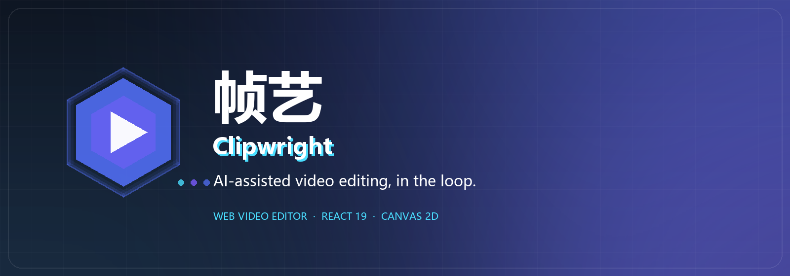
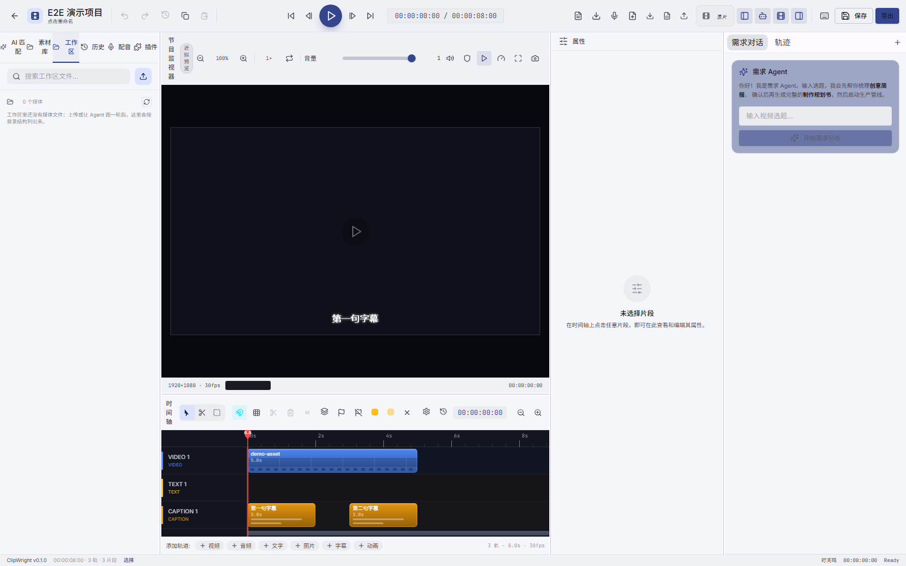

<div align="center">



# 帧艺 · Clipwright

**AI-assisted video editing, in the loop.**

A web video editor that refuses to be a one-shot "generate and pray" button.

[English](README.md) · [简体中文](README.zh-CN.md)

<br/>


</div>

## Overview

**Clipwright** is the web front end of the Clipwright AI video-creation system: a full timeline editor with a
Canvas 2D engine, a frame-accurate preview, and an Agent that works *inside* the editor rather than beside it.
That Agent is a **main agent** that plans the work and dispatches **stage subagents** (structure, material, edit,
animation, audio, quality); every subagent run is visible, replayable and drill-down-able in the editor.

The product loop is deliberately human-in-the-loop:

> Agent drafts → you review on the timeline → ask the Agent to redo a section → export when it feels right.

It is not "one prompt, one video, take it or leave it". Every Agent output lands as editable clips, and every
question, tool call and degradation is visible in the session timeline.

<br/>



<p align="center"><sub>The editor: multi-track timeline, frame-accurate preview, and the requirements Agent on the right.</sub></p>

## Key Features

- **Frame-accurate Canvas 2D timeline** — multi-track video/text/caption/audio/effect editing, keyframes,
  snapping, ripple/roll edits and a custom renderer that stays smooth with hundreds of clips.
- **Agent in the loop, not in the way** — one main agent owns the plan and dispatches stage subagents
  (structure, material, edit, animation, audio, quality). Their drafts arrive as normal timeline clips, each
  subagent run is a card you can open and drill into, and nothing is committed behind your back — review, tweak,
  or reject locally.
- **One clock, one preview** — absolute-time playhead anchoring, decode budget capped at two active videos,
  and canvas compositing that matches the final render as closely as the browser can.
- **Structured GenUI, contract-driven** — the Agent can render cards (plans, briefs, reviews) from *declarative
  specs* shipped by plugins; the front end only renders what the plugin contract allows, and falls back to
  plain entities when no contract is available.
- **Plugin-first architecture** — providers, export presets, animation types, panel slots and GenUI specs are
  plugin contributions. Disable a plugin and its capability disappears — no hidden built-ins.
- **Real-time by SSE** — task events, session timeline, render progress and agent streaming share one
  sequencing model, with resume-by-`seq` after refresh.
- **Local workspace as a single source of truth** — uploads go to `materials/` in the project workspace;
  the media tree, preview and export all read the same files.
- **Bilingual UI with a console-grade admin surface** — providers, plugins, type maker, pipeline inspector,
  model tests, and more, all driven by the engine's contracts instead of hard-coded forms.
- **Tested where it hurts** — 1.2k+ unit tests, Playwright E2E for the editor and the Agent paths, and
  `tsc --noEmit` in CI.

## Quick Start

Clipwright runs as two processes: the **engine** (Python API, port 8080) and this **web editor**
(Vite, port 5173).

### Prerequisites

- **Node.js 20+** and npm
- **Python 3.12+** and pip
- **MongoDB** (engine metadata) and **ffmpeg** on `PATH`

### 1. Start the engine

```bash
git clone https://github.com/Zam233/Clipwright_Enigine.git
cd Clipwright_Enigine

python -m venv .venv
# Windows: .venv\Scripts\activate    macOS/Linux: source .venv/bin/activate
pip install -e ".[dev]"

cp .env.example .env          # Windows: copy .env.example .env
# make sure MongoDB (mongod) is running
python -m clipwright.main     # serves http://localhost:8080
```

On Windows you can skip the manual steps and start everything at once:

```powershell
powershell -ExecutionPolicy Bypass -File scripts\start.ps1
```

`scripts\start.ps1` checks `ffmpeg` and the model cache, starts MongoDB, the engine on `:8080`
and this editor on `:5173` (add `-NoFrontend` to run the engine only). It expects the editor at
`J:\Clipweight-Client`; if yours lives elsewhere, adjust the `$frontend` path at the top of the script.

### 2. Start the web editor

```bash
git clone https://github.com/Zam233/Clipweight_Client.git
cd Clipweight_Client

npm ci
npm run dev
```

Open <http://localhost:5173>. The Vite dev server proxies `/api` to the engine (`:8080`).

> 2026-11-08：账号/市场服务（ClipWright Server，`:8090`）已剥离——没有登录、注册、CREADIT 与市场；
> 需要鉴权时在「设置 → 后端连接」配置本地 API 令牌。

## Tech Stack

| Layer | Choice |
| --- | --- |
| Framework | React 19 + TypeScript 5.5 |
| Build | Vite 6 |
| State | Zustand 5 (domain-split stores) |
| Routing | TanStack Router (route-level lazy loading) |
| Data | TanStack Query + Axios |
| UI | Radix UI + in-house shadcn-style components + Tailwind CSS 4 |
| Timeline | In-house **Canvas 2D engine** (frame precision) |
| Preview | Canvas compositing + keyframe interpolation |
| Realtime | SSE (task events / session timeline / render progress / agent stream) |

## License

[Mozilla Public License 2.0](LICENSE) © Clipwright contributors.
