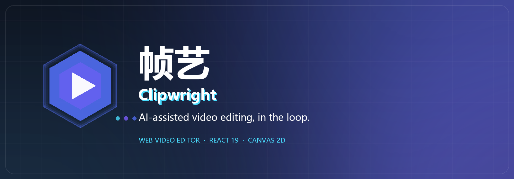
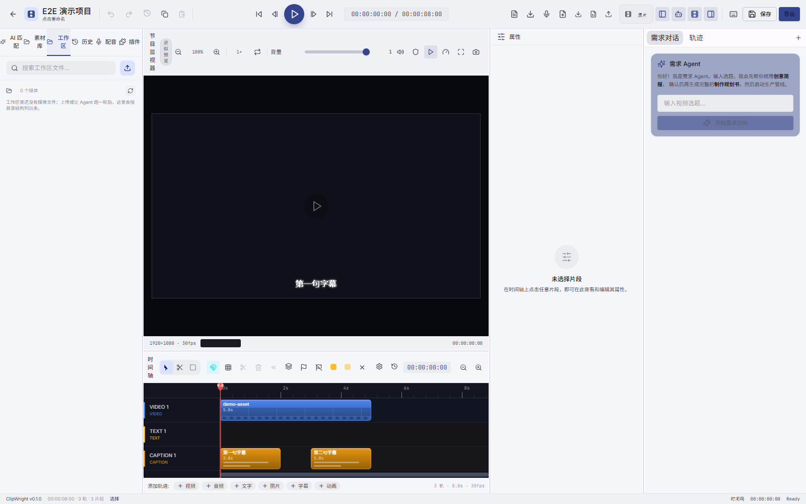

<div align="center">



# 帧艺 · Clipwright

**人在回路的 AI 视频剪辑。**

一个拒绝做「一键生成、只能接受或放弃」的 Web 视频编辑器。

[English](README.md) · [简体中文](README.zh-CN.md)

<br/>


</div>

## 简介

**帧艺 Clipwright** 是 Clipwright AI 视频创作系统的 Web 前端：一个带 Canvas 2D 时间轴引擎、
帧级精确预览的完整时间轴编辑器，并把 Agent 嵌进编辑器内部，而不是放在旁边当一个按钮。
这个 Agent 是**一个主 Agent + 多个阶段子 Agent**：主 Agent 负责规划，把结构、素材、剪辑、动画、音频、质检
派给阶段子 Agent；每次子 Agent 运行都可见、可重放、可在编辑器里下钻。

产品逻辑刻意做成**人在回路**：

> Agent 出初稿 → 你在时间轴上审阅 → 局部不满意让 Agent 重做 → 满意后导出。

不是「一个提示词生成一整条片子，只能接受或放弃」。Agent 的每一次产出都落成**可编辑的片段**；
每一次提问、工具调用与降级，都如实出现在会话时间线里。

<br/>



<p align="center"><sub>编辑器：多轨时间轴、帧级预览，右侧是需求 Agent。</sub></p>

## 核心特性

- **帧级 Canvas 2D 时间轴**：视频 / 文字 / 字幕 / 音频 / 特效多轨编辑，关键帧、吸附、波纹与滚动编辑，
  自研渲染器在数百片段下仍保持流畅。
- **Agent 在回路里，而不是挡在路上**：一个主 Agent 负责规划，把结构、素材、剪辑、动画、音频、质检派给
  阶段子 Agent；它们的草稿就是普通时间线片段，每次子 Agent 运行都是一张可下钻的卡片，
  可以逐段审阅、微调或整段退回，不会在背后偷偷替你提交。
- **单一时钟、单一预览**：播放头用绝对时间锚点，解码预算最多两路视频，Canvas 合成尽量贴近最终成片。
- **可插拔的插件贡献面**：模型 provider、导出预设、动画类型、面板插槽与 GenUI spec 都是插件贡献；
  禁用插件，对应能力就消失——没有隐藏的内置兜底。
- **SSE 实时链路**：任务事件、会话时间线、渲染进度与 Agent 流式输出共用一套序号模型，
  刷新后按 `seq` 续传。
- **工作区是唯一真相**：上传写入项目工作区的 `materials/`，素材树、预览与导出读同一份文件。
- **双语界面 + 控制台级管理面**：模型提供商、插件、类型制作器、管线监控、模型测试等，
  表单由引擎下发的 schema 驱动，而不是手写死字段。
- **在真正会疼的地方测试**：1200+ 单测、覆盖编辑器与 Agent 路径的 Playwright E2E，CI 里跑 `tsc --noEmit`。

## 快速开始

Clipwright 由两个进程组成：**引擎**（Python API，端口 8080）与**本 Web 编辑器**（Vite，端口 5173）。

### 前置条件

- **Node.js 20+** 与 npm
- **Python 3.12+** 与 pip
- **MongoDB**（引擎元数据）与 **ffmpeg**（需在 `PATH` 中）

### 1. 启动引擎

```bash
git clone https://github.com/Zam233/Clipwright_Enigine.git
cd Clipwright_Enigine

python -m venv .venv
# Windows: .venv\Scripts\activate    macOS/Linux: source .venv/bin/activate
pip install -e ".[dev]"

cp .env.example .env          # Windows: copy .env.example .env
# 确认 MongoDB（mongod）已在运行
python -m clipwright.main     # 服务地址 http://localhost:8080
```

Windows 上也可以跳过手工步骤，一键拉起全部进程：

```powershell
powershell -ExecutionPolicy Bypass -File scripts\start.ps1
```

`scripts\start.ps1` 会先体检 `ffmpeg` 与模型缓存，然后启动 MongoDB、引擎（`:8080`）与本编辑器（`:5173`）；
加 `-NoFrontend` 只启引擎。脚本默认按 `J:\Clipweight-Client` 查找前端，路径不同请改脚本顶部的 `$frontend`。

### 2. 启动 Web 编辑器

```bash
git clone https://github.com/Zam233/Clipweight_Client.git
cd Clipweight_Client

npm ci
npm run dev
```

打开 <http://localhost:5173>。Vite 开发服务器把 `/api` 代理到引擎（`:8080`），`/srv` 代理到账号服务（`:8090`）。

## 技术栈

| 层 | 选型 |
| --- | --- |
| 框架 | React 19 + TypeScript 5.5 |
| 构建 | Vite 6 |
| 状态 | Zustand 5（按域拆分 store） |
| 路由 | TanStack Router（路由级懒加载） |
| 数据 | TanStack Query + Axios |
| UI | Radix UI + 自建 shadcn 风格组件 + Tailwind CSS 4 |
| 时间轴 | **自研 Canvas 2D 引擎**（帧级精度） |
| 预览 | Canvas 合成 + 关键帧插值 |
| 实时 | SSE（任务事件 / 会话时间线 / 渲染进度 / Agent 流） |

## 许可证

[Mozilla Public License 2.0](LICENSE) © Clipwright contributors。
