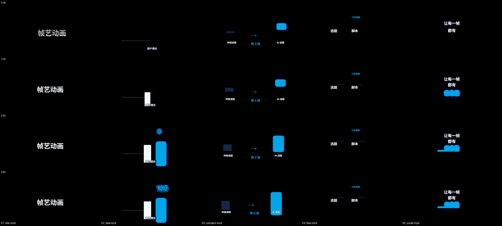

# 动画 Agent 5 个生成预览

生成链：`AnimationAgent` 同源的 `MGGenerator` + 模块化 prompt/AnimationPlan，1920x1080 / 30fps，Hyperframes draft 预览。

| # | 镜头 | Prompt 要点 | 输出 |
|---|---|---|---|
| 01 | 标题揭示 | 「帧艺动画」单主角、冷色科技感、hold | [01_title.mp4](01_title.mp4) |
| 02 | 数据冲击 | 用户增长 120%、柱状图、数字计数 | [02_data.mp4](02_data.mp4) |
| 03 | 左右对比 | 传统流程慢 vs AI 流程快、箭头指出差异 | [03_compare.mp4](03_compare.mp4) |
| 04 | 三步流程 | 选题 → 脚本 → 剪辑、节点依次点亮 | [04_flow.mp4](04_flow.mp4) |
| 05 | 金句强调 | 让每一帧都有信息量、逐词升起、关键词标记 | [05_quote.mp4](05_quote.mp4) |

时间轴抽帧：

## 本次观察

- 01 标题揭示：单主角、hold 正常，动效克制；
- 02 数据：count-up 与柱状图能出现，但底部标签/数字区域偏挤；
- 03 对比：两侧卡片与箭头能表达差异，但构图偏小；
- 04 流程：节点和箭头可见，第三个节点靠近右侧安全区；
- 05 金句：逐词入场可读，但生成的装饰形状不符合「下划线」语义。

这些是生成质量样本，不是最终验收成片；下一轮应针对安全区、元素数量、装饰语义增加规则/验证。
