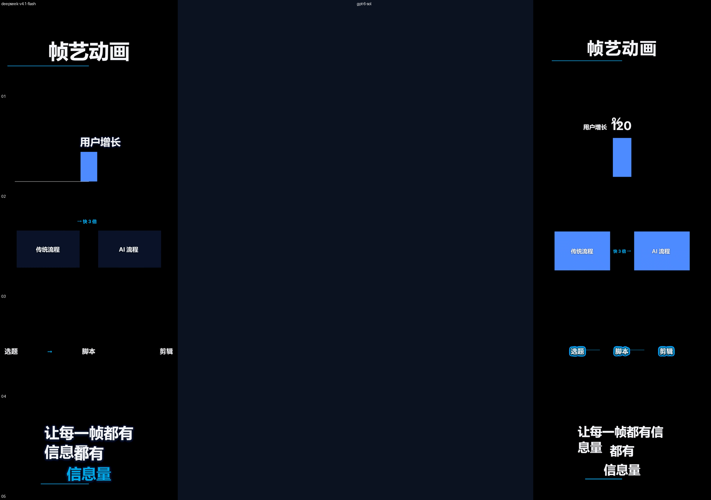

# DeepSeek V4.1 Flash vs GPT-6 SOL

同一套动画 prompt + brief + 自动布局 + QA，在 5 个样本上各生成一遍。

## 样本

| 样本 | DeepSeek V4.1 Flash | GPT-6 SOL |
|---|---|---|
| 01 标题 | [mp4](./deepseek-v4.1-flash/01_title.mp4) | [mp4](./gpt-6-sol/01_title.mp4) |
| 02 数据 | [mp4](./deepseek-v4.1-flash/02_data.mp4) | [mp4](./gpt-6-sol/02_data.mp4) |
| 03 对比 | [mp4](./deepseek-v4.1-flash/03_compare.mp4) | [mp4](./gpt-6-sol/03_compare.mp4) |
| 04 流程 | [mp4](./deepseek-v4.1-flash/04_flow.mp4) | [mp4](./gpt-6-sol/04_flow.mp4) |
| 05 金句 | [mp4](./deepseek-v4.1-flash/05_quote.mp4) | [mp4](./gpt-6-sol/05_quote.mp4) |

## 观察

- 01：两者都能把下划线放在文字下方；DeepSeek 标题偏左，GPT-6 更居中。
- 02：DeepSeek 柱体与标签基本分离；GPT-6 的数字层级更明显。
- 03：DeepSeek 卡片偏暗、信息密度低；GPT-6 卡片对比更强，但颜色偏饱和。
- 04：DeepSeek 节点为裸文字 + 箭头；GPT-6 给节点加了蓝色底板，信息更强但装饰更多。
- 05：两者都出现重复子行（“都有/信息量”），说明**去重归一化还没有完全覆盖占位符拆分**，是后续要修的点。

这不是审美排名，而是同一管线下的模型差异样本；最终成片仍以人工审片为准。
